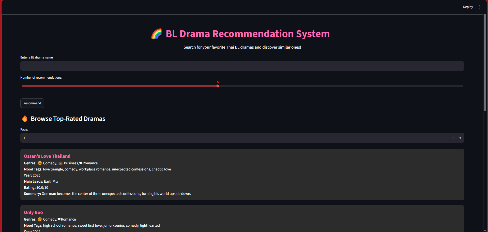
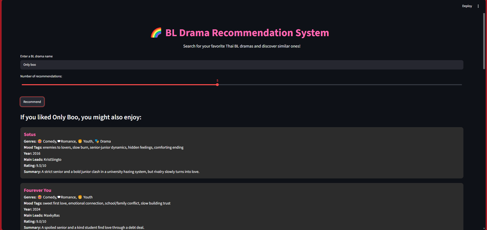
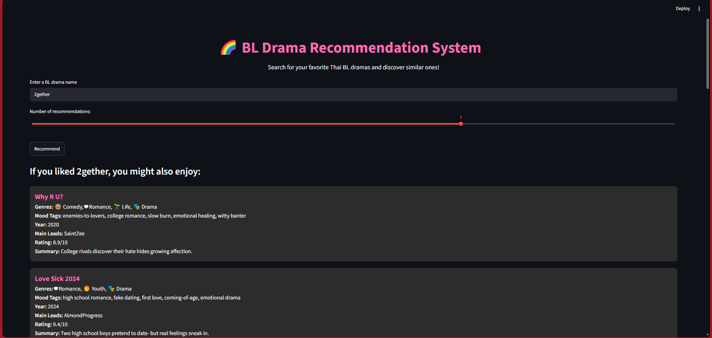

# 🌈 BL Drama Recommendation System

An interactive **content-based recommendation system** for Thai BL (Boys' Love) dramas, developed using **Python, Natural Language Processing (NLP), Scikit-learn, and Streamlit**.

The application recommends dramas based on similarities in **genres, mood tags, plot summaries, and main leads**, combining TF-IDF vectorization with cosine similarity. It also provides flexible title searching and an interactive browser for discovering top-rated dramas.

## 📸 Application Preview

### Homepage & Top-Rated Drama Browser


### Personalized Recommendations — Only Boo (5 Results)


### Adjustable Recommendation Count — 2gether (7 Results)


## 🚀 Key Features

- **Content-Based Recommendations:** Discover dramas with similar content using TF-IDF and cosine similarity.
- **Flexible Title Search:** Fuzzy matching supports variations in drama titles and user input.
- **Customizable Recommendation Count:** Adjust the number of suggested dramas using an interactive slider.
- **Top-Rated Drama Browser:** Explore dramas sorted by personal ratings, with pagination.
- **Rich Drama Information:** View genres, mood tags, summaries, main leads, release years, and personal ratings.
- **Interactive Interface:** Streamlit-based interface with genre emojis and hover effects.

## 🧠 Recommendation Methodology

1. **Data Preparation:** Use drama metadata from the CSV dataset, including genres, mood tags, summaries, and main leads.
2. **Text Representation:** Apply TF-IDF vectorization to represent drama descriptions as numerical feature vectors.
3. **Similarity Calculation:** Use cosine similarity to measure content similarity between dramas.
4. **Title Matching:** Apply fuzzy matching to accommodate variations in search queries.
5. **Recommendation Generation:** Return similar dramas and display their available metadata in the Streamlit interface.

**Approach:** Content-based filtering using textual metadata. Recommendations are based on content similarity rather than collaborative user-rating histories.

## 🛠 Technology Stack

| Category | Technologies |
| --- | --- |
| Programming | Python |
| Web Application | Streamlit |
| Data Processing | Pandas |
| NLP / Feature Extraction | TF-IDF Vectorization |
| Machine Learning | Scikit-learn, Cosine Similarity |
| Search Matching | FuzzyWuzzy |

## 📂 Dataset

The project uses `BL_Drama_Recommendation.csv`, containing the following fields:

- **Title** — Drama name
- **Genres** — Genre categories, including emoji labels
- **Mood Tags** — Descriptive mood or theme labels
- **Summary** — Plot description
- **Main Leads** — Lead actors or characters
- **Year** — Release year
- **Personal Ratings** — Subjective ratings used for browsing and display

**Note:** Personal ratings are subjective and should not be interpreted as an objective model evaluation metric.

## ⚙️ Installation and Usage

### 1. Clone the Repository

```bash
git clone https://github.com/SaakshiJatav/BL-Drama-Recommendation-System.git
cd BL-Drama-Recommendation-System/BL-Drama-Recommendation-System
```

### 2. Install Dependencies

```bash
python -m pip install -r requirements.txt
```

### 3. Run the Streamlit Application

```bash
python -m streamlit run app/main.py
```

Once the application starts, open the local URL displayed in the terminal (typically `http://localhost:8501`).

## 💡 How to Use

1. Enter a drama title or keyword in the search field.
2. Select the number of recommendations using the slider.
3. Click **Recommend** to view similar dramas.
4. Explore the recommended titles and their available details.
5. Use the **Top-Rated Dramas** section to browse additional titles.

## 🔍 Scope and Limitations

- Recommendations are generated from the drama metadata available in the dataset.
- Similarity scores reflect textual content similarity, not guaranteed viewer preferences.
- Fuzzy title matching improves search flexibility but may not resolve every ambiguous query.
- Personal ratings are used for presentation and browsing, not as evidence of recommendation accuracy.

## 👩‍💻 Author

**Saakshi Jatav**

- [GitHub](https://github.com/SaakshiJatav)
- [LinkedIn](https://www.linkedin.com/in/saakshi-jatav/)

---

*Developed as a practical application of NLP, content-based filtering, and interactive Python application development.*
